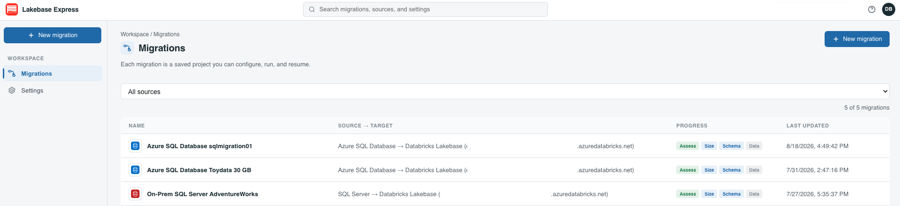

# Lakebase Express

[](https://github.com/databricks-solutions/lakebase-express/actions/workflows/ci.yml)
[](https://databricks-solutions.github.io/lakebase-express/)

A Databricks App that guides you through migrating a transactional database to
**Databricks Lakebase** (managed serverless Postgres), through a connector
catalog. It's a **migration engine, not a code generator**: you review and edit
each artifact, and the app applies the schema/code and streams the data into
Lakebase itself, with live progress.

Enabled sources today: **Azure SQL** and **SQL Server**. More (Oracle,
PostgreSQL, MySQL, …) "Coming soon".

**Documentation: [databricks-solutions.github.io/lakebase-express](https://databricks-solutions.github.io/lakebase-express/)**



> **Disclaimer.** This is **not an official Databricks product or service**. It is
> an independent, community/solution accelerator provided **"as is", without any
> warranty or support commitment**, and carries **no SLA**. Databricks is not
> liable for its use. **You are solely responsible** for reviewing every generated
> artifact, validating the migration against your own requirements, testing on
> non-production data first, securing credentials, and verifying the results
> before relying on them. Migrating databases is inherently risky — always keep
> verified backups of your source and target. See [`LICENSE.md`](LICENSE.md) for
> the full terms.

> **Try it in dev/QA first.** Point the app at a non-production source and a
> throwaway Lakebase target until you've seen a full cycle — assessment, plan,
> apply, data load, validation — succeed on your own schema. Plan items execute
> real DDL against the target and the data load can truncate target tables, so a
> first run belongs somewhere you can drop and recreate.

## Prerequisites

- **Databricks CLI** ≥ 0.239, authenticated to your workspace
  (`databricks auth login`) — used to deploy the app.
- **Node.js** and **npm** — to build the React frontend.
- **Python** 3.10+ (tested on 3.13) — for local development and running tests.
- A **Databricks workspace** with a **Lakebase** database instance (the migration
  target).
- A **source database** — Azure SQL or SQL Server — reachable from the app
  (a firewall rule for the app's egress IP, or a private link).
- A **Databricks secret scope** holding the Lakebase role password under
  `lakebase-password` — the app errors on every request without it. The app runs as
  its own service principal, which needs an ACL on that scope; `deploy.sh` grants
  it, provided you hold **MANAGE** there.

The scan and assessment run without a Databricks workspace; the Foundation Model
features and the Job-offload/Async data paths require one, plus
[grants on `system.ai`](https://databricks-solutions.github.io/lakebase-express/docs/installation/#foundation-model-access). The source
login needs [read-only grants](https://databricks-solutions.github.io/lakebase-express/docs/installation/#source-database-grants) to be assessable.

## Quick Start

Deploy it as a Databricks App.

```bash
# 1. Authenticate the CLI (pick any profile name)
databricks auth login --host <workspace-url> --profile <your-profile>

# 2. Set your deploy target — which workspace the bundle deploys to.
#    target.yml is gitignored (per-user), so create it from the sample:
cp target.yml.sample target.yml
#    Then edit target.yml:
#      * name the target after your CLI profile (<your-profile>), so deploy.sh
#        matches them automatically;
#      * set projects_pg_host / projects_pg_user to your Lakebase instance and
#        role (required — the app won't start without them).

# 3. Create the secret scope and store the Lakebase role password in it.
#    Required with the default `postgres` project store — the app reads this key
#    the first time it touches the store, and errors on every request without it.
databricks secrets create-scope lakebase-express --profile <your-profile>
databricks secrets put-secret lakebase-express lakebase-password --profile <your-profile>

# 4. Build the SPA, deploy the bundle, grant scope access, and start the app
DATABRICKS_PROFILE=<your-profile> ./deploy.sh
```

`deploy.sh` builds `frontend/dist`, renders `app.yaml` from the bundle's resolved
app config, runs `databricks bundle deploy`, grants the app's service principal
`WRITE` on the secret scope, then `databricks bundle run` to launch the app. When
it finishes it prints the app URL — open it and:

1. **New migration** → pick a source connector.
2. **Connections & Target** — enter the source (Azure SQL / SQL Server) and the
   Lakebase target, and test both.
3. Work through **Assessment → Schema & Code → Data Migration → Create Sync** to
   scan, plan, and run the migration.
4. After migrating, use the **Post-migration** modules — **Validation** and
   **Query Parity** — to confirm the target matches the source.

Deployment options, the permissions the app's service principal needs, and the
Lakebase role async runs use are in [Installation](https://databricks-solutions.github.io/lakebase-express/docs/installation/).

## What it does

Work is organized into **migration projects** — a saved unit (source/target
config, object selection, assessment, plan, run history) you create, leave, and
resume. Modules are **independent and always enabled** — no forced sequence.

| Module | What it does |
|--------|--------------|
| **Connections & Target** | Configure and test the source and the Lakebase target once; every other module reuses them |
| **Assessment** | Deterministic scan and rule-based compatibility report, augmented by an AI migration analysis; maps source capacity to Lakebase CUs and cost |
| **Schema & Code** | Build an editable plan (DDL + AI-translated code) and apply it to Lakebase |
| **Data Migration** / **Create Sync** | Stream data into Lakebase in-app (batched `COPY`) with live progress, or offload a re-runnable PySpark snapshot to a Databricks Job; failed runs resume |
| **Validation** *(post-migration)* | Re-scan both sides and match every object — structure, collations, exact row counts, constraints, indexes, FKs — then remediate with an AI repair agent, one-shot AI fixes, or manual SQL |
| **Query Parity** *(post-migration)* | Run generated read-only queries on both sides and compare row count, result format, and performance |
| **App Migration Skill** *(post-migration)* | Export a `SKILL.md` describing how the database's contract with application code changed |
| **Migration Report** *(post-migration)* | Export the whole audit cycle as one printable HTML/PDF report |

## Documentation

| | |
|---|---|
| [Motivation](https://databricks-solutions.github.io/lakebase-express/docs/motivation/) | What it is, what it is not, and the disclaimer |
| [Installation](https://databricks-solutions.github.io/lakebase-express/docs/installation/) | Deploy as a Databricks App: bundle target, secret scope, grants, network |
| [User guide](https://databricks-solutions.github.io/lakebase-express/docs/guide/) | The migration workflow, module by module — including sync and async loads |
| [Architecture](https://databricks-solutions.github.io/lakebase-express/docs/architecture/) | Engine, connectors, persistence, and the REST API |
| [Reference](https://databricks-solutions.github.io/lakebase-express/docs/reference/) | Configuration, Foundation Models, collations, limitations, troubleshooting |
| [Development](https://databricks-solutions.github.io/lakebase-express/docs/dev/) | Project layout, local development, tests, CI/CD, adding a connector |

The site's source is [`docs/lakebase-express/`](docs/lakebase-express/) — see
[Authoring the docs](https://databricks-solutions.github.io/lakebase-express/docs/dev/docs_authoring/).

## Local development

```bash
DATABRICKS_CONFIG_PROFILE=<your-profile> ./run_local.sh   # backend :8000 + Vite :5173
```

Run the tests exactly as CI does:

```bash
pip install --require-hashes --no-deps -r requirements-dev.lock
pytest tests/
ruff check .
```

More in [Developer onboarding](https://databricks-solutions.github.io/lakebase-express/docs/dev/).

## How to get help

Databricks support doesn't cover this content. For questions or bugs, please open
a GitHub issue and the team will help on a best effort basis. See
[`NOTICE.md`](NOTICE.md).

## License

&copy; 2026 Databricks, Inc. All rights reserved. The source in this repository is
provided subject to the Databricks License
[https://databricks.com/db-license-source](https://databricks.com/db-license-source).
All included or referenced third party libraries are subject to the licenses set
forth below.

Provided **"as is", without warranty of any kind** — not an official Databricks
product; see the disclaimer at the top. Full terms in [`LICENSE.md`](LICENSE.md).

| library | description | license | source |
|---------|-------------|---------|--------|
