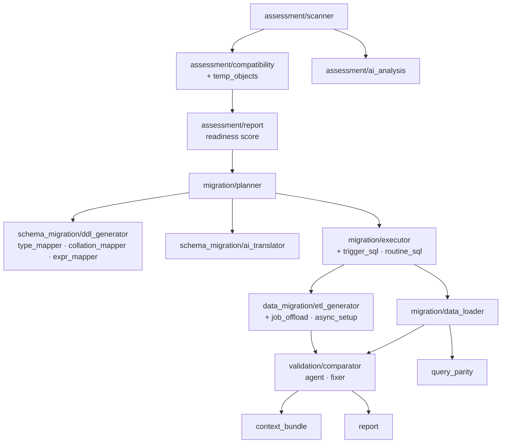
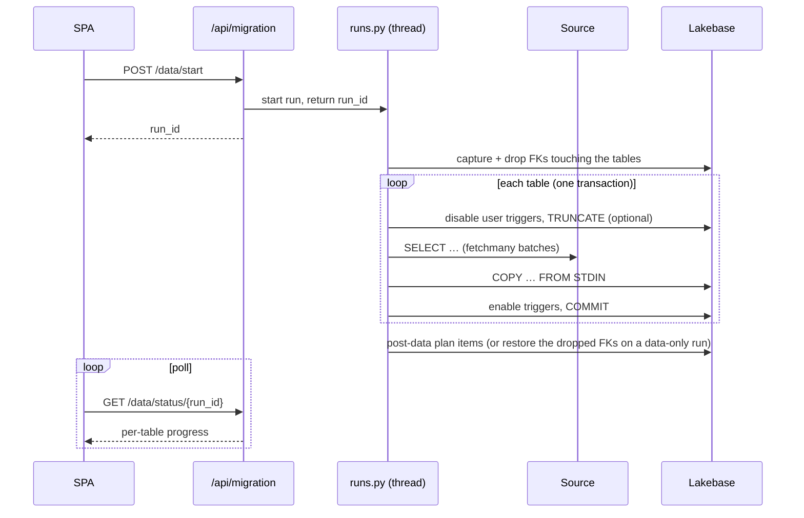

# Migration engine

The engine is the framework-free Python under `backend/`. Each phase has its own package,
a Pydantic contract in `models.py`, and its tests.

## Assessment — `backend/assessment/`

| Module | Role |
|--------|------|
| `scanner.py` | Reads the source's catalog views and produces an `AssessmentReport` |
| `compatibility.py` | Rule engine: type, collation, code and temp-object rules. **Rules are data** — add a row, get a finding |
| `temp_objects.py` | Decides whether each `#temp` / `@t TABLE` becomes a CTE, a PL/pgSQL variable or a working table, from how the body uses it. One analysis drives the finding, the translator's prompt guidance, and the guardrail that flags a translation that emitted a temp table anyway |
| `callable_shape.py` | Whether a procedure returns a result set (and so must become a function) |
| `report.py` | Severity counts and the readiness score |
| `ai_analysis.py` | The fail-soft model deep-dive over the scan |

Sizing lives separately in `backend/sizing/` (`calculator.py` + `pricing.yaml`).

## Schema & code — `backend/schema_migration/` and `backend/migration/planner.py`

`planner.py` builds the plan: one `PlanItem` per object, carrying the exact SQL to apply,
the original T-SQL and the model's reasoning. Items are split into pre-data and post-data
kinds (`POST_DATA_KINDS`).

| Module | Role |
|--------|------|
| `type_mapper.py` | The authoritative SQL Server → Postgres type mapping (`compatibility.py` decides *whether* a type is noteworthy; this decides *what it becomes*) |
| `ddl_generator.py` | Schemas, collations and `CREATE TABLE`; the post-data constraints, indexes and identity syncs, all idempotent |
| `collation_mapper.py` | SQL Server collation → ICU collation — see [Collations](../reference/collations.mdx) |
| `expr_mapper.py` | Deterministic translation of defaults, CHECK predicates and filtered-index predicates; unknown constructs pass through verbatim |
| `windows_timezones.py` | Windows time-zone names → IANA (generated from CLDR; regenerate rather than hand-edit) |
| `naming.py` | Source → target name mapping (`dbo` → `public`, lower-casing or preserved casing) |
| `ai_translator.py` | T-SQL → PL/pgSQL through the Foundation Model, with structured output `{reasoning, translated, notes}`, a defensive parse, deterministic validation with one corrective retry, and a bare-SQL multi-pass fallback for replies past the output window |
| `trigger_sql.py`, `routine_sql.py` | Deterministic fix-ups applied **where SQL is applied** (the executor and the async notebook), so a plan built earlier or edited by hand still applies cleanly: strip a schema-qualified trigger name, upgrade to `CREATE OR REPLACE TRIGGER`, drop a stale routine of the opposite kind when a procedure becomes a function |

## Apply and load — `backend/migration/`

| Module | Role |
|--------|------|
| `executor.py` | Applies plan items in dependency order, each in its own transaction; transient errors retry on a fresh connection |
| `plan_runs.py` | Background plan builds (translations run concurrently) |
| `data_loader.py` | `fetchmany` + `COPY … FROM STDIN`, one transaction per table; drops and restores FKs and disables user triggers around the load |
| `runs.py` | Background sync runs, heartbeat, and resume |
| `job_offload.py` | Uploads the generated notebooks and provisions the per-project snapshot job |
| `async_setup.py`, `async_runs.py` | Async-mode provisioning, and the `async_job` / `async_run` records |
| `secret_setup.py` | Creates or updates the runtime secret scope the job reads |

`backend/data_migration/etl_generator.py` generates the PySpark snapshot notebook. Its
templates are plain strings with `__TOKEN__` placeholders, so the generated Python can
contain f-strings and braces without escaping.

A sync run, end to end:

## Post-migration

| Package | Role |
|---------|------|
| `validation/comparator.py` | Source inventory (the assessment scanner), target inventory (Postgres catalogs, limited to mapped schemas), and a pure `compare` |
| `validation/agent.py`, `fixer.py` | The autonomous repair loop and the one-shot fix. Their prompts are siblings — the agent's SQL is applied unreviewed — so they are edited as a pair |
| `query_parity/` | `generator.py` (model), `runner.py` (read-only guard, both sides), `comparator.py` (pure, three axes) |
| `context_bundle/` | `builder.py` + `rules.py` derive the context deterministically; `skill.py` renders `SKILL.md`; `ai_notes.py` is the optional model pass |
| `report/` | `builder.py` derives the report from stored state; `html.py` renders the self-contained page |
