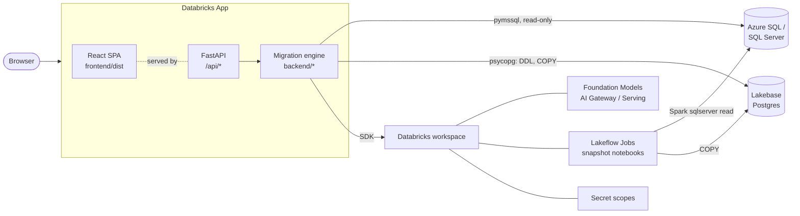

# Architecture overview

Lakebase Express is a single process: a **FastAPI** backend that holds all the migration
logic and also serves the compiled **React** single-page app. Deployed, it runs as a
Databricks App under its own service principal.

## Pieces

| Piece | Where | Role |
|-------|-------|------|
| SPA | `frontend/` | React + Vite + TypeScript. One module per migration step; types in `frontend/src/api.ts` mirror the backend's Pydantic models 1:1 |
| API | `backend/api/` | One FastAPI router per phase, mounted under `/api/*` — see [REST API](./api.mdx) |
| Engine | `backend/assessment`, `schema_migration`, `migration`, `data_migration`, `validation`, `query_parity`, `context_bundle`, `report`, `sizing` | Pure Python with no web framework, so it is reusable from notebooks and unit-testable without Databricks — see [Migration engine](./engine.mdx) |
| Connectors | `backend/connectors/` | The source drivers, the Lakebase target, and credential handling — see [Connectors](./connectors.mdx) |
| Persistence | `backend/projects/`, `run_store.py`, `run_registry.py`, `connectors/credential_store.py` | Projects, run state and credentials, each with a durable and an ephemeral backend — see [Persistence](./persistence.mdx) |
| Deployment | `databricks.yml`, `deploy.sh`, `target.yml` | The bundle that declares the app and its runtime env — see [Installation](../installation.mdx) |

In production the SPA is built into `frontend/dist` and served by the same FastAPI process:
`/assets/*` directly, everything else falling back to `index.html` for client-side routing.
`GET /api/health` is the liveness check.

## Design rules

These run through the whole codebase:

- **Long work runs in the background.** The Databricks Apps front proxy drops a request
  after about 120 seconds, so plan builds, data loads, validation, repair, query parity and
  model notes run on daemon threads; the API returns a `run_id` and the UI polls its status.
  Run state is written through to the run store — see
  [Run state](./persistence.mdx#run-state).
- **Deterministic first, the model where it helps.** Scanning, type and collation mapping,
  scalar expressions and every export are rule-based. The Foundation Model translates code,
  analyzes risk, proposes fixes and generates parity queries.
- **AI is fail-soft.** Every model-backed helper returns `success=False` with an error
  instead of raising, so the deterministic result always survives a failed call.
- **Fail visibly.** Unrecognized SQL passes through verbatim and fails at apply time in its
  own transaction, where it can be edited — it is never silently rewritten.
- **Shared transient retry.** Everything that crosses a network — the scan, plan executor,
  data loader and model calls — retries transient failures under one policy in
  `backend/retry.py`. Each driver classifies its own errors, since only it can tell a
  resuming database from a bad password.
- **One workspace per process.** Auth is the ambient Databricks identity, resolved once
  through the SDK's auth chain (`backend/config.py`): a CLI profile locally, the app's
  injected service-principal OAuth when deployed. There is no in-app workspace login.

## Foundation Model calls

All chat calls go through `backend/fm_params.py`, which sends only the parameters each
model accepts (a static policy plus an adaptive fallback that strips a parameter the server
rejects, and clamps `max_tokens` to the endpoint's window). The API that carries them is
selectable — see [Foundation Models](../reference/foundation_models.mdx).

System prompts are Jinja templates in a `prompts/` directory beside the code that uses them
(`backend/prompts.py` loads them), so they can be read and tuned as prose. The per-object
user message stays in Python, because it is mostly logic.
