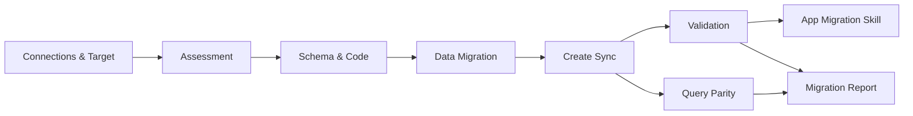

# The migration workflow

Work in Lakebase Express is organized into **migration projects**. A project is a saved
unit — source and target coordinates, object selection, assessment, plan and run history —
that you create, leave, and resume from the **Migrations** list.

## Starting a migration

1. Open the app URL that `deploy.sh` printed (or `http://localhost:5173` locally).
2. **New migration** → pick a source connector from the catalog (Azure SQL or SQL Server).
3. The project opens on its **Overview**: the journey, the status of each stage, and the
   next step.

## The modules

Modules are **independent and always enabled** — there is no forced sequence. Connections
are configured once and reused; a module whose input is missing shows a hint that links to
the module that provides it.

| Step | Module | Page |
|------|--------|------|
| 1 | **Connections & Target** — source and Lakebase, tested once | [Connections](./connections.mdx) |
| 2 | **Assessment** — scan, compatibility, AI analysis, sizing & cost | [Assessment](./assessment.mdx) |
| 3 | **Schema & Code** — the editable migration plan | [Schema & Code](./schema_and_code.mdx) |
| 4–5 | **Data Migration** and **Create Sync** — in-app (sync) or job (async) loads | [Data migration: sync and async](./data_migration.mdx) |
| post | **Validation** — object-by-object comparison and repair | [Validation](./validation.mdx) |
| post | **Query Parity** — synthetic queries run on both sides | [Query Parity](./query_parity.mdx) |
| post | **App Migration Skill** — a `SKILL.md` for the application's migration | [App Migration Skill](./app_migration_skill.mdx) |
| post | **Migration Report** — the audit deliverable | [Migration Report](./migration_report.mdx) |

## Naming on the target

- SQL Server schemas map 1:1 to Postgres schemas, except `dbo`, which maps to `public`.
- By default schema and object names are **lower-cased** (`SalesLT.Product` →
  `saleslt.product`), the PostgreSQL convention, so references need no quoting.
- A project can instead **preserve source casing** (the *Identifier casing* option on the
  Lakebase target). Generated SQL always double-quotes identifiers, so the case-sensitive
  names remain usable by applications that already quote them.
- Column names are always kept as scanned.
- System objects (`sys`, `INFORMATION_SCHEMA`, `is_ms_shipped`, …) are never migrated.

## Settings

**Settings** (left navigation) shows the workspace the app is bound to, lets you pick the
Foundation Model endpoint for the session, and has a **Storage** panel that says where
projects, credentials and run state are kept and whether each survives a restart.

The app is bound to exactly **one** Databricks workspace: locally the CLI profile it was
started with, deployed the workspace the app is published in. Restart with a different
profile to switch.
